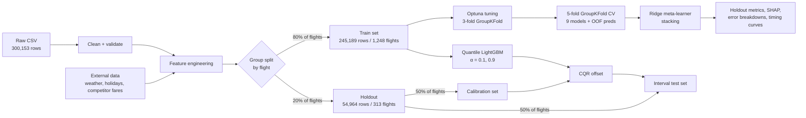
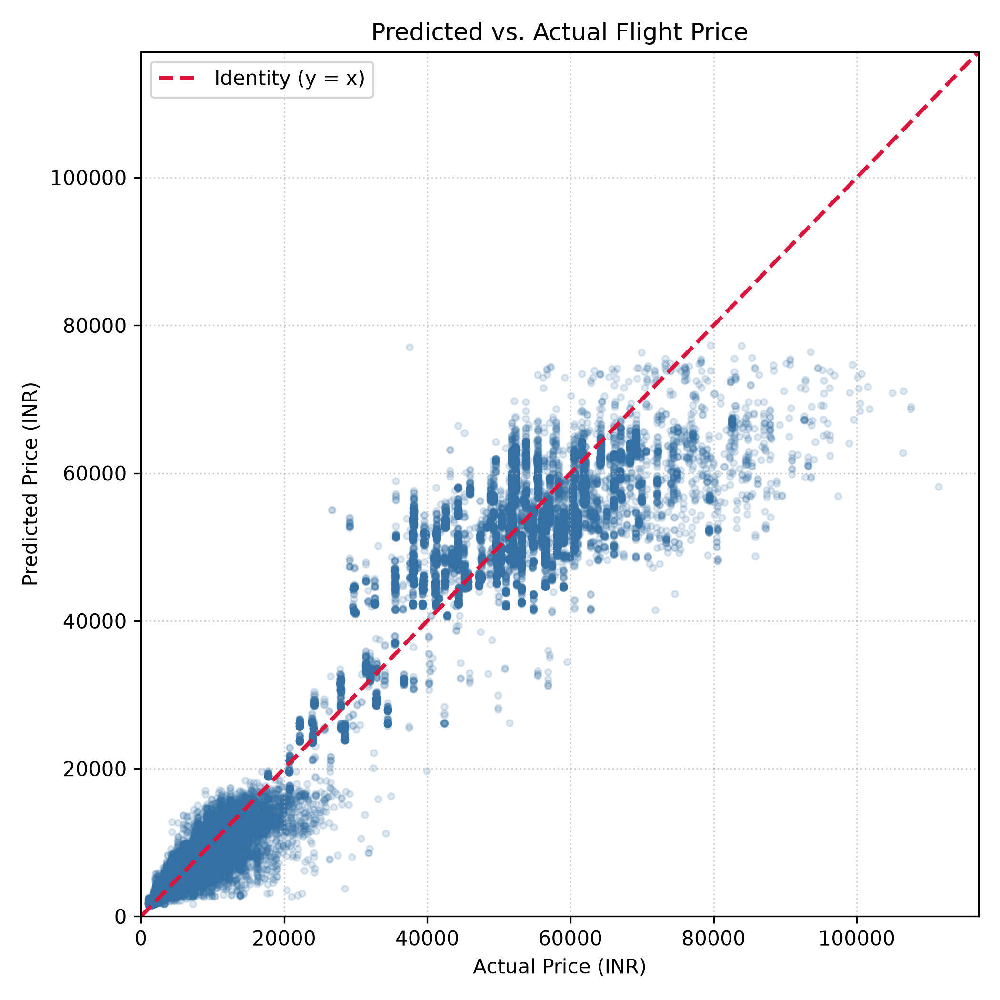
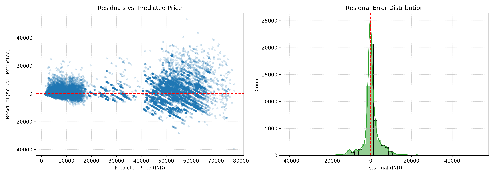
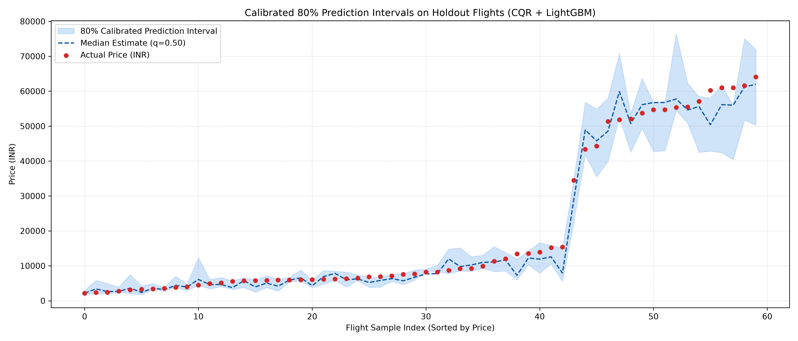
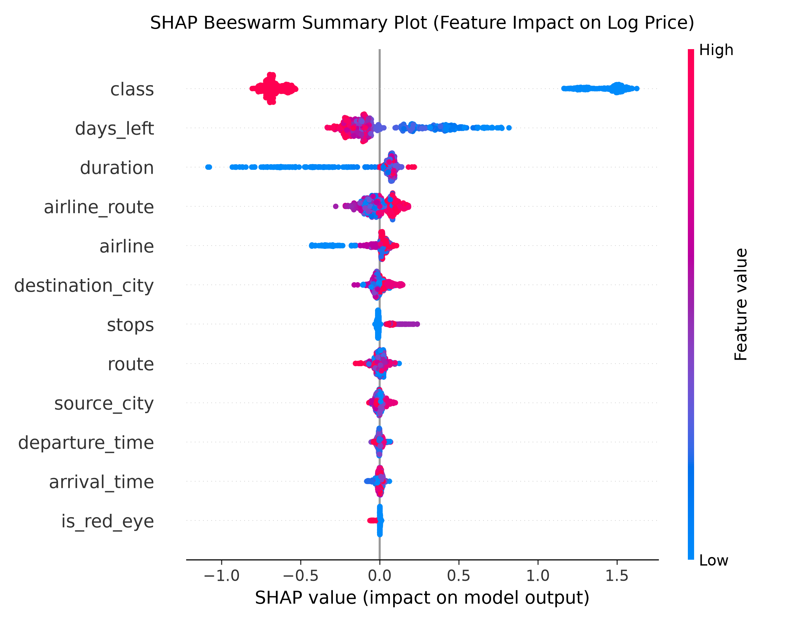
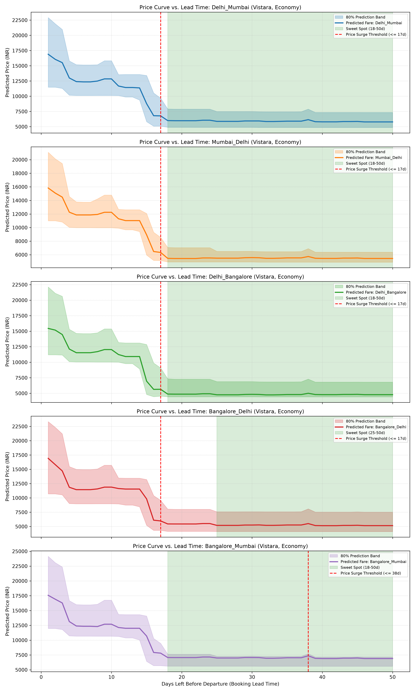
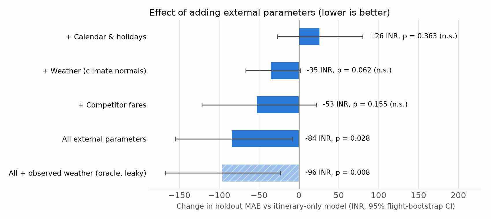
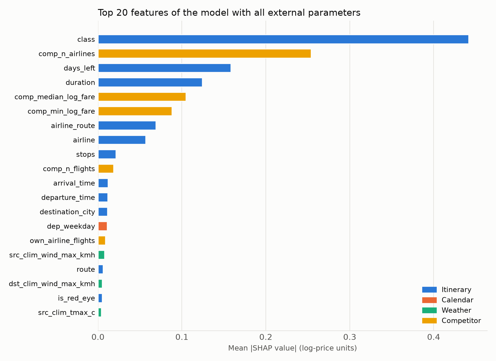

# Leakage-Safe, Explainable Flight Price Prediction with Calibrated Prediction Intervals

**CS 391L Machine Learning — Final Project Report**

*Authors: [Name 1], [Name 2]* · *November 2026*

---

## Abstract

We predict the price of a domestic Indian airline ticket from its itinerary and booking lead time using 300,153 fare quotes for 1,561 distinct flights. Each flight appears many times in the data, once for every lead time, so a random train/test split puts copies of the same flight on both sides. We show that this standard practice understates test error by 21.8% (616.64 INR MAE). Under a leakage-safe split that holds out *entire flights*, a tuned LightGBM model reaches a test MAE of 2,693.73 INR ($R^2 = 0.957$). This is 83% lower than a median baseline and 44% lower than Ridge regression. A four-model stacking ensemble matches LightGBM but does not beat it (paired bootstrap $p = 0.997$). Raw quantile regression intervals cover only 70.73% of test prices at a nominal 80% level. Conformalized Quantile Regression (CQR) raises coverage to 78.91% while widening the average interval by only 5.8%. SHAP analysis shows that cabin class, lead time, and duration drive predictions, and three independent importance methods agree on the ranking (Spearman $\rho$ up to 0.957). Simulated fare curves show a flat plateau beyond about 18 days and a steep premium inside about two weeks of departure. Finally, we recover each fare's departure date from the data and add 20 external parameters: weather climate normals, the holiday and weekday calendar, and competitor fares. Together they lower test MAE by a further 84 INR (3.1%, $p = 0.028$) and make 80% intervals 5.5% narrower at the same coverage, although no single group is significant on its own.

---

## 1. Introduction

**The problem.** Airline fares for the same seat change from day to day under revenue-management systems that travellers cannot see [21]. A traveller looking at a ticket wants to know three things: *Is this price reasonable? How much could it vary? Would booking at a different time be cheaper?* A model that predicts fares from public itinerary attributes can answer the first question. A calibrated interval answers the second, and a lead-time analysis answers the third.

**Why it matters.** Most published fare predictors report a single number with no uncertainty, and they are often evaluated with random cross-validation. In fare data the same flight number appears dozens of times, at different lead times, with highly correlated prices. A random split therefore scores the model partly on flights it has effectively already seen. It measures memorization rather than generalization to a new flight, which is the case that matters for deployment. This kind of *leakage* is a known failure mode in applied machine learning [10, 11], but it is easy to miss in this domain.

**Our approach.** We build an end-to-end, reproducible pipeline with six parts:

1. Every split and every hyperparameter search groups rows by flight number (`GroupKFold`, `GroupShuffleSplit`), so no flight appears in both training and evaluation.
2. We recover each fare's departure date and enrich the quote with **external parameters**: weather, holidays and weekdays, and competitor fares. All of them are restricted to information that was available on the day the fare was searched.
3. We benchmark ten models: two naive baselines, two regularized linear models, five tree ensembles (including gradient boosting [25]), and a stacked ensemble. All are trained on log price.
4. We wrap quantile gradient boosting in CQR [3] to obtain prediction intervals with a finite-sample coverage guarantee.
5. We explain the best model with exact TreeSHAP [4, 5] and cross-check it against permutation and CatBoost importances.
6. We sweep lead time with the trained model to describe the shape of the fare curve on the busiest routes.

**Main results.**

1. Random K-fold overstates accuracy by 21.8% and hides how much performance varies between folds (MAE standard deviation 14.60 vs 182.01 INR).
2. Gradient-boosted trees clearly beat linear and naive models. The best four tree models are statistically indistinguishable from each other.
3. CQR repairs the under-coverage of raw quantile regression at small cost in interval width.
4. Lead time is the second most important input after cabin class, and the predicted fare curve has a "cliff" roughly two weeks before departure.
5. External parameters help jointly (−84 INR MAE, $p = 0.028$; narrower intervals). Competitor fares carry the most signal, weather climate normals help a little, and the calendar alone does not help.

---

## 2. Problem Definition and Algorithm

### 2.1 Task Definition

**Data.** We use the public *Flight Price Prediction* dataset [1]. It contains economy and business fares scraped from the Indian travel site EaseMyTrip for flights between six metro cities (Delhi, Mumbai, Bangalore, Kolkata, Hyderabad, Chennai) on six airlines in early 2022. The data has no missing values and no duplicate rows (`results/tables/data_cleaning_log.csv`).

**Dates.** `Clean_Dataset.csv` has no date column, but `days_left` takes exactly 49 values (1–49), matching the 49 departure days from 11 February to 31 March 2022 in the dataset description [1]. The data confirms that each `days_left` value is one fixed calendar day. Mean Economy fare across `days_left` has a clear **7-day cycle**: the autocorrelation of the detrended series is +0.56 at a 7-day lag and +0.72 at 14 days, but −0.56 at 3 days. Flights that skip days skip them on a weekly pattern (85% agreement at a 7-day lag vs 77% at 5 days). All fares were therefore quoted on **one search date**, 10 February 2022, and

*departure date = 10 Feb 2022 + `days_left`*.

This date is the key used to attach the external parameters in Section 2.2 (Step 1b).

**Input.** Each observation is a fare quote $\mathbf{x} \in \mathcal{X}$ with nine attributes:

| Attribute | Type | Values |
| :--- | :--- | :--- |
| `airline` | categorical | 6 carriers |
| `source_city`, `destination_city` | categorical | 6 cities each (30 routes) |
| `departure_time`, `arrival_time` | categorical | 6 time-of-day slots each |
| `stops` | categorical | `zero`, `one`, `two_or_more` |
| `class` | categorical | `Economy`, `Business` |
| `duration` | numeric | 0.83–49.83 hours |
| `days_left` | numeric | 1–49 days before departure |

Each quote is also given **20 external attributes** in three groups, keyed by departure date, city, route, and class (details in Step 1b):

| Group | Attributes |
| :--- | :--- |
| Weather (10) | climate normals of rainfall, max/min temperature, max wind, and fog probability at the origin and the destination for the departure day |
| Calendar (5) | departure weekday, weekend-departure flag, signed and absolute days to the nearest public holiday, holiday-window flag |
| Competitor fares (5) | lowest and median fare of *other* airlines on the same route, class, and date; number of competing airlines and their flights; the airline's own flight count |

Each row also carries a **group label** $g$, the flight number (1,561 unique values). The group label is used *only* to construct splits and is never a model input.

**Output.** The model has two outputs:

1. A point prediction $\hat{y} = f(\mathbf{x})$ of the fare $y$ in INR. Fares range from 1,105 to 123,071 INR (median 7,425 INR, mean 20,890 INR). The distribution is bimodal by class and strongly right-skewed.
2. A prediction interval $[\hat{\ell}(\mathbf{x}), \hat{u}(\mathbf{x})]$ such that $P\big(y \in [\hat{\ell}(\mathbf{x}), \hat{u}(\mathbf{x})]\big) \ge 1 - \alpha$ with $1 - \alpha = 0.80$, for a new flight $g$ that was not seen in training.

**Objective.** Minimize expected absolute error $\mathbb{E}\,|y - f(\mathbf{x})|$ on *unseen flights*, and make the interval as narrow as possible subject to the coverage constraint.

**Why it is interesting.** The task combines three practical difficulties: grouped and correlated observations, a heavy-tailed and heteroskedastic target, and a mostly categorical input space with strong interactions (for example, the effect of lead time depends on cabin class). Each difficulty calls for a specific method choice, described next.

### 2.2 Algorithm Definition

The full pipeline is implemented in `scripts/run_all.py` and `src/`.



#### Step 1 — Feature engineering (`src/features.py`)

Starting from the nine raw attributes, we derive six additional features:

| Feature | Definition | Rationale |
| :--- | :--- | :--- |
| `route` | `source_city + "_" + destination_city` | Fares depend on the city pair, not on each endpoint separately |
| `airline_route` | `airline + "_" + route` | Carriers price the same route differently |
| `is_direct` | `stops == "zero"` | Non-stop premium |
| `days_left_bucket` | bins {0–3, 4–7, 8–14, 15–30, 31+} | Lets models see coarse booking windows directly |
| `is_last_minute` | `days_left ≤ 3` | Last-minute surge |
| `is_red_eye` | night departure and morning arrival | Unattractive itineraries are discounted |

For sklearn and LightGBM models, categorical columns are ordinal-encoded (tree models) or one-hot encoded (linear models), and numeric columns are standardized. CatBoost receives the raw categorical strings and uses its native ordered target statistics [7].

#### Step 1b — External parameters (`src/external_features.py`, `scripts/run_external.py`)

Fares also respond to conditions outside the itinerary. Using the departure date (Section 2.1), we attach three groups of external parameters:

| Parameter | Why it affects fares | Source | Join key |
| :--- | :--- | :--- | :--- |
| **Weather (climate normals)** at origin and destination: rainfall (mm), max and min temperature (°C), max wind (km/h), fog probability. Each value is the 2012–2021 average for that city and calendar day (±3 days). | Fog (especially in Delhi) and heavy rain cause delays and cancellations, and airlines and travellers price in the *expected* conditions for the travel date. | Open-Meteo historical weather archive (ERA5 reanalysis) at each city's main airport [26] | City × departure day |
| **Fog probability** (part of the weather group) | Winter radiation fog closes North Indian airports. Proxy: a morning (00–08 h) with mean relative humidity ≥ 90% and mean wind < 8 km/h. | Hourly humidity and wind [26] | City × departure day |
| **Calendar**: departure weekday, weekend-departure flag (Fri–Sun) | Friday and Sunday departures carry more leisure and return-trip demand. | Derived from the departure date | Departure date |
| **Holidays**: signed and absolute days to the nearest gazetted public holiday (Maha Shivaratri, 1 Mar 2022; Holi, 18 Mar 2022); flag for departures within ±3 days | Demand surges around festivals and long weekends (Holi 2022 fell on a Friday). | Government of India holiday list for 2022 [30] | Departure date |
| **Competitor fares**: lowest and median log fare of *other* airlines; number of competing airlines; number of their flights; own-airline flight count | Airlines match or undercut each other on the same route and day. | Computed from the dataset itself | Route × class × departure date |

**Parameters considered but not used.** Two further groups were evaluated and deliberately left out:

- **Jet-fuel (ATF) price [28].** On the single search date, the fuel price is one fixed number per origin city. It would only duplicate `source_city` and cannot add information.
- **Airline demand from DGCA traffic statistics [29].** The latest monthly figures published before the search date are one fixed number per airline, so they would only duplicate `airline`.

Using the fuel price or demand *in force on the departure date* would instead leak information from after the search date. Both groups would become useful with fares collected on many different search dates (Section 5).

**Leakage rules for external parameters.**

1. **Only information available on the search date.** Weather enters as *climate normals*, which a traveller or airline knows in advance. The weather actually observed on the departure day is future information on 10 February 2022, so it is used only in a separate, clearly labelled **oracle** variant that estimates how much perfect weather knowledge could add.
2. **Competitor features exclude the row's own airline.** All fares were quoted on the same search date, so competitors' fares are exactly what a traveller sees on screen alongside the fare being predicted. They are legitimate inputs and contain nothing about the row's own price or its airline's other fares.
3. **External data is joined by date, city, route, or class, never by flight number**, so the group split is unchanged.
4. Numeric external features are standardized and the two flags are passed through, exactly like the itinerary features. Weather downloads are cached in `data/external/`, so the experiment re-runs offline.

#### Step 2 — Log-target regression

Fares span two orders of magnitude, and errors scale with price. We therefore train every model on $z = \log(1 + y)$ and invert predictions with $\hat{y} = \exp(\hat{z}) - 1$. All reported metrics are computed in INR, after inversion.

#### Step 3 — Leakage-safe validation and tuning

```text
Algorithm 1: Grouped training and model selection
Input : rows (x_i, y_i, g_i), models M_1..M_K, folds k = 5
1  (Train, Holdout) <- GroupShuffleSplit(groups = g, test = 20%, seed = 42)
2  for each tunable model M in {Ridge, LightGBM, CatBoost}:
3      θ*_M <- Optuna-TPE(15 trials, objective = mean MAE over
4                         3-fold GroupKFold on Train only)
5  Folds F_1..F_5 <- GroupKFold(Train, groups = g)        # no flight in two folds
6  for each model M_j:
7      for each fold F_f:
8          fit M_j on Train \ F_f ; OOF_j[F_f] <- predict(M_j, F_f)
9      refit M_j on all of Train ; record holdout metrics
10 Fit Ridge(positive = True) meta-learner on [OOF_LGBM, OOF_Cat, OOF_RF, OOF_HGB] -> z
11 Stacked prediction: ẑ = b + Σ_j w_j · M_j(x)
```

Holding out *whole flights* means that each fold measures how well the model prices a flight number it has never seen. Hyperparameters are chosen using training flights only, so the holdout set is never used for any modelling decision. The meta-learner is fit on **out-of-fold** predictions, which prevents it from simply learning to trust whichever base model overfits the most [12, 13]. The non-negativity constraint keeps the ensemble weights interpretable.

#### Step 4 — Conformalized Quantile Regression (`src/intervals.py`)

```text
Algorithm 2: CQR (Romano et al., 2019)
Input : Train, calibration set C (held-out flights), target coverage 1-α = 0.80
1  Fit quantile LightGBM models q_lo (τ = 0.10) and q_hi (τ = 0.90) on Train with pinball loss
2  for each (x_i, y_i) in C:
3      E_i <- max( q_lo(x_i) - y_i ,  y_i - q_hi(x_i) )    # conformity score, in INR
4  Q <- empirical quantile of {E_i} at level ⌈(n+1)(1-α)⌉ / n
5  Interval for a new x:  [ q_lo(x) - Q ,  q_hi(x) + Q ]
```

$E_i$ is positive when $y_i$ falls outside the raw interval and negative when it falls inside. The offset $Q$ therefore widens the interval if the quantile models under-cover and narrows it if they over-cover. Under exchangeability of calibration and test points, the result satisfies $P(y \in \text{interval}) \ge 1 - \alpha$ [3, 16]. We split the holdout set *by flight* into a calibration half (24,611 rows) and an evaluation half (30,353 rows).

#### Step 5 — Explanation and booking-timing simulation

For explanation, TreeSHAP [5] computes exact Shapley values for LightGBM on 1,000 sampled holdout rows. We compare the resulting importance ranking with permutation importance [6, 18] and CatBoost's built-in importance using Spearman rank correlation.

For the timing analysis, we take each of the five busiest routes and fix a "typical" itinerary: the most common airline, stop count, and time slots, the median duration, and Economy class. We then sweep `days_left` from 1 to 50 and predict the fare at each value. The **sweet spot** is the set of lead times whose predicted fare is within 5% of that route's minimum. The **surge threshold** is the largest lead time at which the predicted fare rises by more than 350 INR from one day to the next (moving toward departure).

#### Worked example

We trace one real holdout row through the pipeline: Vistara flight **UK-705** from Delhi to Mumbai, booked **one day** before departure. The flight has one stop, departs in the early morning, arrives in the afternoon, takes 5.5 hours, and is in Economy class. The true fare is **17,400 INR**. Flight UK-705 never appears in the training data.

1. **Features.** `route = Delhi_Mumbai`, `airline_route = Vistara_Delhi_Mumbai`, `is_direct = 0`, `days_left_bucket = "0-3"`, `is_last_minute = 1`, `is_red_eye = 0`. The training target would be $\log(1 + 17400) = 9.764$.
2. **Base models** (log scale, with INR in parentheses):

   | Model | Prediction |
   | :--- | :--- |
   | LightGBM | 9.6943 (16,224) |
   | CatBoost | 9.6956 (16,244) |
   | RandomForest | 9.6911 (16,173) |
   | HistGradientBoosting | 9.6973 (16,273) |

3. **Stacking.** The learned weights are $w = (0.2773, 0.2707, 0.1946, 0.2639)$ with intercept $b = -0.0617$:
   $\hat{z} = -0.0617 + 0.2773(9.6943) + 0.2707(9.6956) + 0.1946(9.6911) + 0.2639(9.6973) = 9.6954$, so $\hat{y} = e^{9.6954} - 1 = $ **16,242 INR**.
   The error is 1,158 INR (6.7%). The base models agree closely here, so stacking changes little. The model correctly recognizes a last-minute fare: the same itinerary at 30+ days is predicted at about 6,000 INR (Figure 5).
4. **Interval.** The quantile models give a raw 80% interval of [11,079, 22,106]. The CQR offset learned on the calibration flights is $Q = +211.32$ INR, so the calibrated interval is **[10,868, 22,317] INR**, which contains the true fare of 17,400 INR.

---

## 3. Experimental Evaluation

### 3.1 Methodology

**Hypotheses.**

- **H1 (leakage):** Random K-fold CV gives a lower, overly optimistic error estimate than grouped K-fold CV on the same model and data.
- **H2 (model class):** Non-linear tree ensembles outperform regularized linear models and naive baselines, and a stacked ensemble outperforms its best single member.
- **H3 (calibration):** Raw quantile regression intervals miss their nominal coverage on unseen flights, and CQR restores coverage close to 80% at modest cost in width.
- **H4 (drivers):** Cabin class and booking lead time are the dominant fare drivers, and removing lead time hurts accuracy more than removing any other single feature group.
- **H5 (external parameters):** Adding external parameters lowers holdout error, with the largest gains for last-minute fares (0–3 days) and budget carriers. We expect competitor fares and holiday proximity to help most. Weather should matter mainly at short lead times and on fog-prone routes.

**Independent variables.** Model family, validation scheme (random vs grouped), feature subsets (ablation, including each external parameter group), interval method (raw vs CQR), and `days_left` (timing sweep).

**Dependent variables.**

- Point accuracy: MAE, RMSE, $R^2$, MAPE, and sMAPE, all in INR space.
- Interval quality: prediction interval coverage probability (PICP, the share of true prices inside the interval) and mean prediction interval width (MPIW).

**Data splits.**

| Split | Rows | Flights | Use |
| :--- | ---: | ---: | :--- |
| Train | 245,189 | 1,248 | Tuning, 5-fold grouped CV, final fit |
| Holdout | 54,964 | 313 | Final point metrics, SHAP, breakdowns |
| ↳ Calibration half | 24,611 | — | CQR offset only |
| ↳ Evaluation half | 30,353 | — | Interval PICP / MPIW |

The split is realistic because, in deployment, a pricing assistant is constantly asked about flight numbers and schedules it has not been trained on. Grouping by flight simulates exactly that situation.

**Competing methods.**

- Median baseline (predict the global median).
- Route-mean baseline.
- Ridge and ElasticNet [14, 15].
- RandomForest [8] and ExtraTrees [9].
- scikit-learn HistGradientBoosting [17].
- LightGBM [6] and CatBoost [7].
- The stacked ensemble.

Ridge, LightGBM, and CatBoost were tuned with Optuna [19]. The other models used fixed, reasonable defaults.

**Statistical analysis.**

- For CV, we report the mean ± standard deviation over the 5 grouped folds.
- To test whether holdout differences are real, we use a **paired flight-level bootstrap** [2] (`scripts/significance_test.py`, 2,000 resamples). We resample the 313 holdout *flights* with replacement and recompute the MAE difference between each model and LightGBM on the same rows. We resample flights rather than rows because rows within a flight are correlated.
- For agreement between importance methods, we use Spearman's $\rho$.

All randomness is seeded (seed = 42). One full run takes about 70 minutes on a laptop CPU.

### 3.2 Results

#### H1 — Leakage from random splits

Same tuned LightGBM, same training rows, 5 folds (`results/tables/kfold_vs_groupkfold.csv`):

| Split | CV MAE (INR) | CV RMSE (INR) | $R^2$ | MAPE |
| :--- | ---: | ---: | ---: | ---: |
| GroupKFold (by flight) | 2,828.50 ± 182.01 | 5,064.54 ± 359.93 | 0.95 | 15.96% |
| Random KFold | 2,211.86 ± 14.60 | 4,012.61 ± 26.17 | 0.97 | 12.83% |

Random KFold reports an MAE that is 616.64 INR (21.8%) lower than grouped CV. It also reports a fold-to-fold standard deviation 12× smaller, giving a false impression of stability. The grouped CV estimate (2,828.50) is close to the true holdout MAE on unseen flights (2,693.73). The random-split estimate is far below the holdout MAE.

#### H2 — Model comparison

Holdout results, sorted by test MAE (`results/tables/model_comparison.csv`, `results/tables/significance_tests.csv`):

| Model | CV MAE (INR) | Test MAE (INR) | Test RMSE (INR) | Test $R^2$ | Test sMAPE | ΔMAE vs LightGBM [95% CI] | $p$ |
| :--- | ---: | ---: | ---: | ---: | ---: | :--- | ---: |
| **LightGBM** | 2,828.50 ± 182.01 | **2,693.73** | **4,687.56** | **0.9566** | 16.02% | — | — |
| Stacking ensemble | 2,781.34* | 2,695.20 | 4,738.08 | 0.9556 | **15.93%** | +1.47 [−77.20, +85.48] | 0.997 |
| HistGradientBoosting | 2,858.90 ± 148.40 | 2,721.31 | 4,740.33 | 0.9556 | 16.03% | +27.58 [−12.69, +63.97] | 0.157 |
| ExtraTrees | 2,982.71 ± 222.98 | 2,740.28 | 4,965.26 | 0.9513 | 16.08% | +46.54 [−83.47, +173.86] | 0.505 |
| RandomForest | 2,984.15 ± 199.82 | 2,843.50 | 5,269.11 | 0.9451 | 16.35% | +149.76 [−8.58, +298.26] | 0.063 |
| CatBoost | 2,933.82 ± 194.63 | 2,952.38 | 5,203.62 | 0.9465 | 17.30% | +258.64 [−1.67, +523.58] | 0.052 |
| Ridge | 4,881.29 ± 296.68 | 4,823.40 | 8,787.43 | 0.8473 | 24.03% | +2,129.67 [+1,738.60, +2,470.85] | <0.001 |
| ElasticNet | 5,273.46 ± 450.48 | 5,014.65 | 8,544.20 | 0.8557 | 28.42% | +2,320.92 [+1,835.07, +2,770.68] | <0.001 |
| Median baseline | 16,233.26 ± 935.23 | 15,772.31 | 25,931.18 | −0.3295 | 76.65% | — | — |
| Route-mean baseline | 16,752.71 ± 849.27 | 16,365.26 | 24,205.85 | −0.1585 | 85.98% | — | — |

\* The stacking CV figure is computed on the same out-of-fold predictions the meta-learner was fit on, so it is slightly optimistic and has no per-fold spread.

The baselines have *negative* $R^2$ because the fare distribution is bimodal by class: any single central value is far from most fares. Tuned Optuna parameters are listed in `results/tables/tuning_results.csv`.



*Figure 1. LightGBM predictions vs true fares on the 54,964 holdout rows. Points follow the identity line closely in Economy (below 20k INR). In Business, predictions are compressed toward about 50–65k, so the most expensive fares (above 80k) are systematically under-predicted. Vertical streaks are groups of rows with identical features but different observed prices: variance that no model can explain from the available attributes.*



*Figure 2. Residual diagnostics for the best model (`results/figures/residual_plots.png`). The learning curve is in `results/figures/learning_curve.png`.*

**Error breakdowns** (LightGBM, holdout; `results/tables/error_breakdown_*.csv`):

| Segment | n | MAE (INR) | MAPE |
| :--- | ---: | ---: | ---: |
| Economy | 38,235 | 1,180.06 | 18.14% |
| Business | 16,729 | 6,153.31 | 11.99% |
| Non-stop | 6,548 | 1,060.71 | 10.09% |
| One stop | 46,045 | 2,963.85 | 16.95% |
| Two or more stops | 2,371 | 1,958.00 | 19.99% |
| 0–3 days left | 1,898 | 4,246.41 | 20.29% |
| 4–7 days left | 3,883 | 3,618.10 | 16.09% |
| 8–14 days left | 7,586 | 3,117.67 | 15.15% |
| 15–30 days left | 18,959 | 2,539.12 | 16.76% |
| 31+ days left | 22,638 | 2,392.42 | 15.92% |

Absolute error rises steadily as departure approaches: from 2,392 INR at 31+ days to 4,246 INR at 0–3 days (+77.5%). By airline, MAPE is lowest for the full-service carriers Vistara (14.15%) and Air India (14.59%) and highest for AirAsia (24.04%) and SpiceJet (23.39%).

#### H3 — Prediction intervals

Measured on the 30,353-row interval evaluation half (`results/tables/prediction_intervals.csv`):

| Method | Target | PICP | MPIW (INR) |
| :--- | ---: | ---: | ---: |
| Quantile LightGBM (raw) | 80% | 70.73% | 7,288.16 |
| **Quantile LightGBM + CQR** | 80% | **78.91%** | 7,710.80 |
| Quantile CatBoost (raw) | 80% | 71.99% | 7,776.10 |
| Quantile CatBoost + CQR | 80% | 77.88% | 8,072.47 |

For LightGBM, CQR added $Q = 211.32$ INR to each side of the interval. This raised coverage by 8.18 percentage points while increasing the mean width by only 422.64 INR (+5.8%).



*Figure 3. 80% prediction intervals on holdout flights (`results/figures/prediction_intervals.png`).*

#### H4 — What drives fares

**Ablation** (fixed LightGBM configuration, holdout; `results/tables/ablation_study.csv`):

| Variant | Test MAE (INR) | ΔMAE | Test MAPE |
| :--- | ---: | ---: | ---: |
| Full feature set | 2,701.00 | — | 16.28% |
| Without `days_left` (and its derived features) | 3,487.47 | +786.47 | 27.49% |
| Without `airline` (and `airline_route`) | 3,259.48 | +558.48 | 22.26% |
| Without route features | 2,778.26 | +77.26 | 16.66% |
| Only `airline` + `class` | 4,598.93 | +1,897.93 | 33.95% |

**Importance and agreement** (`results/tables/feature_importances.csv`, `results/tables/feature_ranking_correlation.csv`). The top five features by mean |SHAP| (log-price units) are `class` (0.899), `days_left` (0.197), `duration` (0.132), `airline_route` (0.069), and `airline` (0.055). The three importance methods rank features consistently:

| Pair | Spearman $\rho$ | $p$ |
| :--- | ---: | ---: |
| LightGBM SHAP vs permutation | 0.957 | < 10⁻⁶ |
| CatBoost importance vs permutation | 0.825 | 1.5 × 10⁻⁴ |
| LightGBM SHAP vs CatBoost importance | 0.764 | 9.1 × 10⁻⁴ |



*Figure 4. SHAP summary for LightGBM. Dependence and interaction plots (`days_left × class`, `stops × duration`) are in `results/figures/shap_*.png`.*

**Booking-timing curves** (`results/tables/booking_timing_sweet_spots.csv`):

| Route (Vistara, Economy, 1 stop) | Min predicted fare (INR) | Sweet spot | Surge threshold | Day-1 premium over sweet spot (INR) |
| :--- | ---: | :--- | :--- | ---: |
| Delhi → Mumbai | 5,784 | 18–50 days | ≤ 17 days | +11,009 |
| Mumbai → Delhi | 5,444 | 18–50 days | ≤ 17 days | +10,342 |
| Delhi → Bangalore | 4,743 | 18–50 days | ≤ 17 days | +10,643 |
| Bangalore → Delhi | 5,149 | 25–50 days | ≤ 17 days | +11,718 |
| Bangalore → Mumbai | 6,902 | 18–50 days | ≤ 38 days | +10,577 |



*Figure 5. Predicted Economy fare vs lead time, with an 80% quantile band, for the five busiest routes. All curves share the same shape: flat beyond about 18 days, a sharp step between about 17 and 14 days, a second plateau between 4 and 14 days, and a final surge in the last 3 days, where predicted fares reach roughly 3× the plateau level.*

#### H5 — External parameters

Each external group is added to the itinerary feature set on its own, then all together. All variants use the same grouped holdout, the same LightGBM configuration as the ablation above, and the same paired flight-level bootstrap (`results/tables/external_ablation.csv`). The first row reproduces the ablation's full-feature result exactly (2,701.00 INR).

| Feature set | Test MAE (INR) | ΔMAE [95% CI] | $p$ | Test $R^2$ | Test MAPE | MAE at 0–3 days (INR) | MAPE, AirAsia + SpiceJet |
| :--- | ---: | :--- | ---: | ---: | ---: | ---: | ---: |
| Itinerary only | 2,701.00 | — | — | 0.9556 | 16.28% | 4,251.24 | 23.93% |
| + Calendar & holidays (5) | 2,726.94 | +25.94 [−26.56, +80.16] | 0.363 | 0.9555 | 16.21% | 4,191.03 | 23.30% |
| + Weather, climate normals (10) | 2,665.97 | −35.03 [−66.69, +1.77] | 0.062 | 0.9571 | 16.07% | 4,148.49 | 23.60% |
| + Competitor fares (5) | 2,648.18 | −52.82 [−121.57, +21.90] | 0.155 | 0.9570 | 15.87% | 4,531.04 | 23.53% |
| **All external parameters (20)** | **2,616.91** | **−84.09 [−155.13, −8.14]** | **0.028** | **0.9577** | **15.85%** | 4,540.80 | 23.49% |
| All + observed weather (oracle, leaky) | 2,604.55 | −96.45 [−167.68, −23.14] | 0.008 | 0.9582 | 15.74% | 4,459.65 | 22.87% |



*Figure 6. Change in holdout MAE from adding each external group, with 95% flight-bootstrap confidence intervals. Only the combined set is significant at α = 0.05. The hatched oracle bar uses weather that was not yet known on the search date and is shown only as an upper bound.*

**Prediction intervals with external parameters** (CQR, same calibration and evaluation halves as H3; `results/tables/external_intervals.csv`):

| Feature set | Raw PICP | CQR PICP | CQR MPIW (INR) | CQR offset $Q$ (INR) |
| :--- | ---: | ---: | ---: | ---: |
| Itinerary only | 70.73% | 78.91% | 7,710.80 | 211.32 |
| All external parameters | 70.42% | **79.42%** | **7,290.37** | 177.85 |

With all external parameters the calibrated intervals are **420 INR (5.5%) narrower** while coverage *rises* from 78.91% to 79.42%. The required conformal correction also shrinks (211 → 178 INR), meaning the raw quantile models are better specified.

**Feature importance** (mean |SHAP| on 2,000 holdout rows, model with all external parameters; `results/tables/external_feature_importance.csv`). Summed by group: itinerary 0.920, competitor 0.474, weather 0.034, calendar 0.015. The top external features are `comp_n_airlines` (rank 2 of 35), `comp_median_log_fare` (5), `comp_min_log_fare` (6), `comp_n_flights` (10), `dep_weekday` (14), and the origin's normal maximum wind (16).



*Figure 7. Top 20 features of the model with all external parameters, coloured by group.*

### 3.3 Discussion

**H1 is supported, strongly.** Leakage is the largest single effect in the study. The 616.64 INR gap between random and grouped CV is larger than the gap between LightGBM and every non-linear competitor. In other words, a careless split would change the reported performance more than choosing a different model family would. The explanation is structural: within one flight, rows differ only in `days_left`, so a model that has seen neighbouring lead times of the same flight can interpolate rather than generalize. This also explains why random-split folds look unrealistically stable (standard deviation 14.60 INR). Each fold contains nearly the same flights, so the folds are not independent tests. Grouped CV produced an estimate (2,828.50) close to the true unseen-flight error (2,693.73), which validates it as the model-selection criterion.

**H2 is partly supported.** Tree ensembles beat linear models by more than 2,100 INR MAE ($p < 0.001$) and beat the baselines by about 13,000 INR. The reason is that fares are driven by interactions: lead-time effects differ by class, airline, and route. A linear model in one-hot space cannot represent these interactions without explicit cross terms. However, *the stacked ensemble did not beat LightGBM* (ΔMAE = +1.47 INR, $p = 0.997$). In fact none of the four best tree models differ significantly from one another at α = 0.05. The base learners make highly correlated errors: in the worked example their predictions were within 0.006 log units of each other. With such correlated errors, a weighted average has almost no variance to remove [12]. The meta-learner's nearly equal weights (each about 0.19–0.28) confirm that no model added unique information. In practice, a single LightGBM model is the better choice: it is as accurate, simpler, and faster. CatBoost's weaker showing (p = 0.052, borderline) probably reflects its shorter tuning budget (250 iterations) rather than a real limitation of the method.

**H3 is supported.** The raw quantile models under-covered by about 9 percentage points. Pinball-loss boosting is fit to the training distribution, while unseen flights add flight-level variance the training fit never saw. CQR estimates exactly that missing variance on *held-out flights*, which is why grouping the calibration split matters. The calibrated intervals are still 1.09 points short of 80%. The finite-sample guarantee assumes exchangeable points, but our calibration and evaluation sets are exchangeable at the *flight* level, not the row level, and the guarantee is marginal rather than conditional. A single additive offset also cannot adapt to the very different spread in Economy and Business fares: the same 211 INR is large for a 5,000 INR fare and negligible for a 60,000 INR fare.

**H4 is supported.** Cabin class dominates every importance measure, which is unsurprising because Business fares are about 8× higher. Among the remaining features, lead time is the most important: removing it raised MAPE from 16.28% to 27.49%, the largest drop of any ablation. Removing the engineered route features (`route` and `airline_route`) costs only +77 INR MAE, because trees can largely reconstruct them from `airline`, `source_city`, and `destination_city`. The close agreement of SHAP, permutation, and CatBoost importances ($\rho$ up to 0.957) suggests the ranking reflects the data rather than one model's quirks.

**Caveats on the timing results.** The fare curves are model-based *conditional expectations* computed from observational data. They are not causal statements: waiting does not "cause" a price change, and the scraped data contains no seat-inventory information. The surge threshold produced by the 350 INR/day rule is sensitive to small wiggles in the curve. For Bangalore → Mumbai it fires at 38 days because of a one-day bump (visible in Figure 5), not a real cliff. Visually, the true cliff on all five routes lies between about 14 and 17 days.

**Where the model is weak.** Errors concentrate in three places: (i) Business fares above about 80k INR, which are under-predicted (Figure 1); (ii) the last three days before departure; and (iii) budget carriers (AirAsia and SpiceJet MAPE above 23%). In all three cases the price depends on information the itinerary attributes do not contain. The vertical streaks in Figure 1 show this directly: rows with identical itinerary features have widely different prices. The external parameters of Step 1b (competitor fares, holiday proximity, and short-range weather) target exactly these segments.

**H5 is partly supported.** Together, the external parameters give a significant improvement: −84 INR MAE ($p = 0.028$), higher $R^2$ (0.9577 vs 0.9556), and 5.5% narrower intervals at slightly *better* coverage. No single group is significant on its own, though. Their small, partly independent effects only add up to a reliable gain when combined. Three findings go against our prior expectations:

1. **Competitor fares made last-minute errors worse** (0–3-day MAE 4,251 → 4,531 INR), even though they lowered overall error. Close to departure, each airline's price is driven by its own remaining seats, which are not observed, so other airlines' fares become a misleading anchor. In every other lead-time bucket they help: −77 INR at 15–30 days, −63 at 31+ days, −57 at 8–14 days, and −35 at 4–7 days, against +280 at 0–3 days.
2. **Calendar features alone did not help** (+26 INR, n.s.). With a single search date, the departure date is a one-to-one function of `days_left`, so weekday and holiday distance are only *re-encodings* of information the model already had. Trees can find the 7-day pattern only with many splits, which explains why `dep_weekday` still earns a modest SHAP rank (14) in the combined model.
3. **Actual weather adds almost nothing beyond climate normals.** The oracle variant improves on the legitimate model by only 12 INR. The window was also unusually benign: Delhi saw 4.2 mm of rain and a single fog-like morning across all 49 departure days. Most of the weather group's value therefore comes from describing each city's typical conditions, not day-to-day events, and a winter-fog or monsoon window would be a much stronger test.

**Interpreting the competitor SHAP rank.** `comp_n_airlines` ranks second, but mostly as a stand-in for cabin class. Only Air India and Vistara sell Business, so the competitor count is 1 for 93,465 of 93,487 Business rows and 3–5 for almost all Economy rows. SHAP divides credit between correlated features, which is why `class` receives 0.442 here, against 0.899 in the itinerary-only model of Section 3.2. The genuinely new information is in the competitor *fare* levels (`comp_median_log_fare`, `comp_min_log_fare`).

**Budget carriers improved only slightly** (MAPE 23.93% → 23.49%). Their fares depend on promotions and seat inventory more than on what competitors charge.

---

## 4. Related Work

**Etzioni et al. (2003), "To Buy or Not to Buy" [20].** The authors collected over 12,000 fare observations on US routes and trained a mix of rule learning, Q-learning, and time-series methods to decide, for a specific trip, whether to buy now or wait. Their problem is sequential decision-making on repeated price observations of the *same* trip, and they report savings rather than prediction error. *Difference:* we solve the regression problem behind that decision, adding calibrated uncertainty and leakage-safe evaluation. Our snapshot data contains no repeated observations over time for a single booking, so we cannot evaluate a buy/wait policy. Our results complement theirs rather than improving on them.

**Groves & Gini (2013) [22].** The authors built purchase-timing models from automated, user-guided feature selection over large sets of historical fare features, again with the goal of choosing a purchase date. *Difference:* we use a small set of interpretable features and explain the model with SHAP rather than through feature selection. Our grouped evaluation addresses a leakage risk that also applies to their setting, where the same flight is observed repeatedly.

**Tziridis et al. (2017) [23].** The authors compared eight regression methods (including bagged trees, random forests, and neural networks) for airfare prediction on a single route and found tree ensembles strongest. *Difference:* our dataset is about 300× larger, covers 30 routes and 6 airlines, and our comparison uses grouped CV and a paired significance test. Our finding that tree ensembles win agrees with theirs. We additionally show that the differences *among* the best ensembles are not statistically significant, and that random-split scores are optimistic.

**Public analyses of this dataset [1].** Many publicly shared notebooks on this Kaggle dataset train on a random row-level train/test split. Our H1 experiment shows that such scores overstate accuracy on unseen flights by about 22% in MAE. We offer our grouped protocol as a more honest benchmark.

**Methodological foundations.** We adopt CQR [3] (building on split conformal prediction [16, 24]) rather than plain split conformal because quantile regression adapts the interval width to each input, which suits a target with very different spread across classes. We use TreeSHAP [4, 5] instead of only impurity-based importance, which can be biased toward high-cardinality features. We follow the leakage literature [10] and blocked/grouped CV for structured data [11]. Our contribution is combining these established tools into one reproducible, leakage-aware pipeline for fare prediction, and measuring how much each one matters.

---

## 5. Future Work

| Shortcoming | Proposed remedy |
| :--- | :--- |
| **No time-based evaluation.** All results use a group split by flight. | The departure and search dates attached in Step 1b make a forward-chaining split by search date possible. Report it alongside the group split. |
| **Under-prediction of expensive Business fares.** | Train class-specific models, or use a loss suited to heavy tails (Tweedie or Gamma deviance), and add features such as fare-class codes if available. |
| **Marginal coverage only; intervals 1.1 points short and not class-adaptive.** | Use class-conditional (Mondrian) conformal prediction, normalize scores by predicted width, or compute conformity scores at the group level so the guarantee holds per flight. |
| **Non-causal, single-snapshot timing analysis.** | Frame the problem as buy/wait with repeated price observations of the same itinerary (as in [20]) and evaluate the policy's realized savings. |
| **Seats remaining are not observed.** Revenue-management systems raise prices as cheaper fare buckets sell out, and the dataset does not record seat availability. | Scrape "seats left" or fare-class codes alongside each fare and add them to the external parameters. |
| **One search date and a dry 7-week window.** All fares were quoted on 10 Feb 2022, so calendar features duplicate `days_left`, fuel price and DGCA demand cannot vary, and the weather was unusually benign. | Collect fares on many search dates across a full year. Then the departure date and the lead time vary independently, and ATF prices [28], DGCA demand [29], and short-range weather *forecasts* can be added as genuinely new information. |
| **Competitor fares hurt last-minute predictions.** | Let the model weight competitor information by lead time, for example with separate models or interaction constraints for `days_left` ≤ 3, or by adding a seat-availability proxy. |
| **Limited tuning and one holdout seed.** Only Ridge, LightGBM, and CatBoost were tuned (15 trials each), and results come from one split. | Tune all tree models with a larger budget, repeat the full pipeline over several group-split seeds, and report variability across seeds. |
| **Stacking adds nothing.** | Diversify base learners (for example, a neural network with categorical embeddings, or a k-NN model on route embeddings), since stacking only helps when models make different errors. |
| **Unused component.** A smoothed route target encoder is implemented in `src/features.py` but not wired into the models. | Add it as an ablation; it may help the linear models in particular. |

---

## 6. Conclusion

We built a reproducible pipeline for predicting Indian domestic airfares, with calibrated intervals and model explanations. The main lessons are:

1. **How you split matters more than which model you pick.** Because fare data contains each flight many times, random CV understates error by about 22%. Grouped validation is required for honest results, and its estimate closely matched true performance on unseen flights.
2. **A single tuned gradient-boosting model is enough.** LightGBM reached 2,694 INR MAE ($R^2 = 0.957$). Stacking and other tree ensembles were statistically indistinguishable from it, while linear models were significantly worse.
3. **Conformal calibration is a cheap fix for overconfident intervals.** CQR lifted 80% interval coverage from 70.7% to 78.9% for a 5.8% increase in width.
4. **Cabin class and lead time drive fares.** Three importance methods agree on this ranking, and the predicted fare curves show a flat plateau beyond about 18 days and a steep, roughly threefold climb in the final two weeks.

5. **External context helps, modestly.** Recovering departure dates from the data let us add weather climate normals, the holiday calendar, and competitor fares. Together they cut MAE by a further 84 INR ($p = 0.028$) and narrowed intervals by 5.5%. Competitor fares carry the most new information. Real-time weather adds little beyond climate normals in this dry season.

For future research, our results argue for reporting grouped, significance-tested benchmarks on repeated-entity data such as this. For applications, a fare assistant can give travellers not only a price estimate but an honest range and a sense of when prices tend to jump. It should, however, present the timing findings as observed patterns, not as guarantees.

---

## Reproducing This Report

```bash
pip install -r requirements.txt
python scripts/run_all.py            # ~70 min; writes results/tables, results/figures, models/
python scripts/significance_test.py  # paired bootstrap table used in Section 3.2
python scripts/run_external.py       # H5: external parameters (~2 min; weather cached in data/external/)
```

Every number in this report comes from a file in `results/tables/` or from the scripts above.

---

## Bibliography

[1] S. Bathwal. *Flight Price Prediction* [Dataset]. Kaggle, 2022. https://www.kaggle.com/datasets/shubhambathwal/flight-price-prediction

[2] B. Efron and R. J. Tibshirani. *An Introduction to the Bootstrap.* Chapman & Hall/CRC, 1993.

[3] Y. Romano, E. Patterson, and E. J. Candès. Conformalized quantile regression. In *Advances in Neural Information Processing Systems 32 (NeurIPS)*, 2019.

[4] S. M. Lundberg and S.-I. Lee. A unified approach to interpreting model predictions. In *Advances in Neural Information Processing Systems 30 (NIPS)*, 2017.

[5] S. M. Lundberg, G. Erion, H. Chen, A. DeGrave, J. M. Prutkin, B. Nair, R. Katz, J. Himmelfarb, N. Bansal, and S.-I. Lee. From local explanations to global understanding with explainable AI for trees. *Nature Machine Intelligence*, 2(1):56–67, 2020.

[6] G. Ke, Q. Meng, T. Finley, T. Wang, W. Chen, W. Ma, Q. Ye, and T.-Y. Liu. LightGBM: A highly efficient gradient boosting decision tree. In *Advances in Neural Information Processing Systems 30 (NIPS)*, 2017.

[7] L. Prokhorenkova, G. Gusev, A. Vorobev, A. V. Dorogush, and A. Gulin. CatBoost: Unbiased boosting with categorical features. In *Advances in Neural Information Processing Systems 31 (NeurIPS)*, 2018.

[8] L. Breiman. Random forests. *Machine Learning*, 45(1):5–32, 2001.

[9] P. Geurts, D. Ernst, and L. Wehenkel. Extremely randomized trees. *Machine Learning*, 63(1):3–42, 2006.

[10] S. Kaufman, S. Rosset, C. Perlich, and O. Stitelman. Leakage in data mining: Formulation, detection, and avoidance. *ACM Transactions on Knowledge Discovery from Data*, 6(4):15:1–15:21, 2012.

[11] D. R. Roberts, V. Bahn, S. Ciuti, M. S. Boyce, J. Elith, G. Guillera-Arroita, S. Hauenstein, J. J. Lahoz-Monfort, B. Schröder, W. Thuiller, D. I. Warton, B. A. Wintle, F. Hartig, and C. F. Dormann. Cross-validation strategies for data with temporal, spatial, hierarchical, or phylogenetic structure. *Ecography*, 40(8):913–929, 2017.

[12] D. H. Wolpert. Stacked generalization. *Neural Networks*, 5(2):241–259, 1992.

[13] L. Breiman. Stacked regressions. *Machine Learning*, 24(1):49–64, 1996.

[14] A. E. Hoerl and R. W. Kennard. Ridge regression: Biased estimation for nonorthogonal problems. *Technometrics*, 12(1):55–67, 1970.

[15] H. Zou and T. Hastie. Regularization and variable selection via the elastic net. *Journal of the Royal Statistical Society: Series B*, 67(2):301–320, 2005.

[16] J. Lei, M. G'Sell, A. Rinaldo, R. J. Tibshirani, and L. Wasserman. Distribution-free predictive inference for regression. *Journal of the American Statistical Association*, 113(523):1094–1111, 2018.

[17] F. Pedregosa, G. Varoquaux, A. Gramfort, V. Michel, B. Thirion, O. Grisel, M. Blondel, P. Prettenhofer, R. Weiss, V. Dubourg, J. Vanderplas, A. Passos, D. Cournapeau, M. Brucher, M. Perrot, and É. Duchesnay. Scikit-learn: Machine learning in Python. *Journal of Machine Learning Research*, 12:2825–2830, 2011.

[18] A. Fisher, C. Rudin, and F. Dominici. All models are wrong, but many are useful: Learning a variable's importance by studying an entire class of prediction models simultaneously. *Journal of Machine Learning Research*, 20(177):1–81, 2019.

[19] T. Akiba, S. Sano, T. Yanase, T. Ohta, and M. Koyama. Optuna: A next-generation hyperparameter optimization framework. In *Proceedings of the 25th ACM SIGKDD International Conference on Knowledge Discovery & Data Mining*, pages 2623–2631, 2019.

[20] O. Etzioni, R. Tuchinda, C. A. Knoblock, and A. Yates. To buy or not to buy: Mining airfare data to minimize ticket purchase price. In *Proceedings of the 9th ACM SIGKDD International Conference on Knowledge Discovery and Data Mining*, pages 119–128, 2003.

[21] K. T. Talluri and G. J. van Ryzin. *The Theory and Practice of Revenue Management.* Springer, 2004.

[22] W. Groves and M. Gini. Optimal airline ticket purchasing using automated user-guided feature selection. In *Proceedings of the 23rd International Joint Conference on Artificial Intelligence (IJCAI)*, pages 150–156, 2013.

[23] K. Tziridis, T. Kalampokas, G. A. Papakostas, and K. I. Diamantaras. Airfare prices prediction using machine learning techniques. In *Proceedings of the 25th European Signal Processing Conference (EUSIPCO)*, pages 1036–1039, 2017.

[24] V. Vovk, A. Gammerman, and G. Shafer. *Algorithmic Learning in a Random World.* Springer, 2005.

[25] J. H. Friedman. Greedy function approximation: A gradient boosting machine. *Annals of Statistics*, 29(5):1189–1232, 2001.

[26] Open-Meteo. Free weather forecast and historical weather API. https://open-meteo.com

[27] India Meteorological Department, Ministry of Earth Sciences, Government of India. https://mausam.imd.gov.in

[28] Indian Oil Corporation Ltd. Aviation turbine fuel (ATF) price notifications. https://iocl.com

[29] Directorate General of Civil Aviation (DGCA), Government of India. Domestic traffic and on-time performance statistics. https://www.dgca.gov.in

[30] Ministry of Personnel, Public Grievances and Pensions, Government of India. List of holidays to be observed in central government offices during the year 2022.
